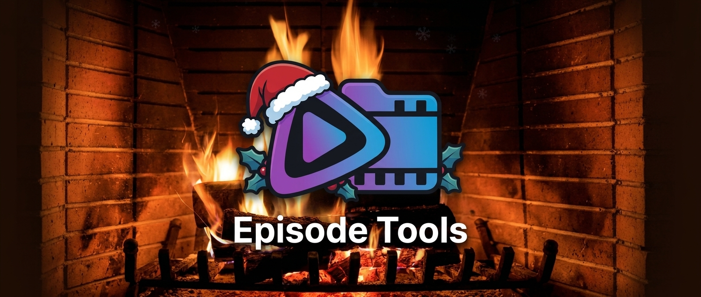

<p align="center">
  
</p>

# Episode Tools (Jellyfin 12 plugin)

A Jellyfin plugin that keeps an anime/series library tidy: it renames episodes, losslessly
remuxes MKV to MP4, repairs wrong subtitle defaults (the classic "opening lyrics instead of
dialogue" problem), audits the library for duplicates, and reports everything in dashboard
pages instead of raw logs.

Everything runs under **Dashboard > Scheduled Tasks > Episode Tools** — seven tasks, each
with a Run button:

1. **Rename episodes: preview** (changes nothing)
2. **Rename episodes** — `Show - S01E02 - Title.mkv`, subtitle language tags kept
3. **Convert MKV to MP4: preview** (changes nothing)
4. **Convert MKV to MP4 (lossless)** — stream copy, no re-encoding, output verified
5. **Check subtitles** (auto-runs every 3 days) — flags signs/songs/lyrics tracks,
   lyrics-heavy content (♪ ratio) and broken timing (subtitles flashing < 0.8s)
6. **Re-convert MKV to MP4 (replaces existing .mp4)** — apply new settings/preferences to
   already-converted episodes; replaces the old file only after verification
7. **Audit library** — duplicate episodes (same show/season/episode in multiple files) and
   the largest video files
8. **Scan intros (fast)** — fingerprints the first few minutes of every episode and finds
   each season's shared opening; the result becomes skippable intro segments

## Dashboard pages

One plugin page under **Dashboard > Plugins** (next to the other plugins), Moonbase-style:
a left sidebar of tabs, a settings search box, and a sticky Save bar.

| Tab | What you get |
|---|---|
| **Settings** | Up to 5 rename folders, up to 5 scan folders, delete-originals, audio-to-AAC, faststart (off = ~2x faster conversion), drop signs/songs tracks, minimum free space guard |
| **Shows** | Every show with episode counts, .mkv-to-convert count and subtitle languages found — plus **per-show default subtitle and audio language** dropdowns, applied at the next conversion |
| **Report** | Every .mkv that could not be converted, and exactly why |
| **Sub Check** | Subtitle problems per episode: default track is a signs/songs/lyrics track, lyrics-heavy content, ultra-short cues |
| **Intros** | Skippable openings found by the fast intro scanner: Scan now / Stop, live progress and a per-season results table that fills in as the scan runs |
| **Audit** | Duplicate episodes and the largest files, grouped and readable |

## How conversions work

- Video and audio are **copied, not re-encoded** — quality stays identical.
- Text subtitles become `mov_text`; image-based (PGS/VobSub) tracks are skipped with a note.
- **Safety checks on every output:** track counts, duration within 1%, plausible size — the
  `.mp4` is only kept when verification passes; the `.mkv` is untouched unless you enable
  deleting.
- **Track selection:** per-show language preferences and signs/songs filtering are applied
  during the remux; the first matching audio/subtitle track is flagged as the player default.
  A language filter that matches nothing keeps everything — it never silently removes all
  subtitles or all audio.
- Files with unusual codecs are skipped with a reason (overridable per run with `--force`);
  DTS/TrueHD/FLAC audio can be re-encoded to AAC per setting.
- Runs at `nice 19` + `ionice -c3` so Jellyfin stays responsive; a lock prevents two
  conversion runs at once; the stop button cleans up half-finished `.part` files.
- `faststart` is optional: off = the file is written once instead of twice (roughly twice as
  fast on slow drives); Jellyfin streams with range requests, so playback is unaffected.

## Requirements

- Jellyfin 12.x (.NET 10, ABI 12.0.0.0)
- `python3`, `bash`, `ffmpeg`/`ffprobe` (Jellyfin's bundled ffmpeg is used automatically)

## Build with GitHub Actions

Any push builds the plugin automatically (`.github/workflows/build.yml`) and keeps the zip
as an artifact. To publish a release, push a tag:

```bash
git tag v3.0.0 && git push origin v3.0.0
```

The workflow attaches `EpisodeTools_3.0.0.0.zip` to the release. Download from the
[Releases page](../../releases).

## Install

**Docker:** copy the zip's contents into `<config folder>/plugins/EpisodeTools_3.0.0.0/`
(the DLL must sit directly in that folder) and restart the container. The container needs
`python3` for the rename/audit tasks — the official Jellyfin image has ffmpeg bundled.

**apt install (Debian):**

```bash
sudo apt install unzip acl
wget https://github.com/<your-user>/<your-repo>/releases/download/v3.0.0/EpisodeTools_3.0.0.0.zip
sudo mkdir -p /var/lib/jellyfin/plugins/EpisodeTools_3.0.0.0
sudo unzip -o EpisodeTools_3.0.0.0.zip -d /var/lib/jellyfin/plugins/EpisodeTools_3.0.0.0
sudo chown -R jellyfin:jellyfin /var/lib/jellyfin/plugins/EpisodeTools_3.0.0.0
sudo setfacl -R -m u:jellyfin:rwX /mnt/storage/media
sudo setfacl -R -d -m u:jellyfin:rwX /mnt/storage/media
sudo systemctl restart jellyfin
```

## Notes

- Settings are stored in
  `plugins/configurations/Jellyfin.Plugin.EpisodeTools.xml` (or
  `/var/lib/jellyfin/plugins/configurations/` for apt installs).
- The rename script treats the first folder under each rename folder as the show name, so
  point rename folders at series roots only.
- Renaming is idempotent and never overwrites: already-correct files are skipped, targets
  that exist are reported.
- Updating: replace the plugin folder's contents with the new zip's and restart Jellyfin.

## Fast intro scanner

The **8. Scan intros (fast)** task finds each season's shared opening sequence and serves it
as standard Jellyfin media segments, so every client gets an intro skip button (segments are
copied into the server's database by the built-in **Extract media segments** task).

Why it is faster than the official Intro Skipper:

- **A smaller default window** — intros always live in the first few minutes, so the default
  window is 4 minutes from the start (configurable 1–15 min). The official Intro Skipper
  defaults to the first 25% of the file up to 10 minutes, so for typical 20–50 minute
  episodes this means roughly half to a third of the audio to fingerprint by default.
- **Parallel decoding** — several episodes are fingerprinted at the same time (default 2,
  up to 8 ffmpeg processes).
- **Per-file cache** — fingerprints are stored keyed on size + mtime + window, so re-scans
  only decode new or changed episodes, and a scan that is interrupted (power cut, restart)
  resumes where it left off. Entries for deleted episodes are pruned automatically.
- **Incremental results** — seasons are compared one at a time and results are saved after
  each season, so intros appear in the Intros tab while the scan is still running.
- The matching itself is the proven chromaprint algorithm (inverted-index search + contiguous
  range finding, like the official plugin), ending with the same silence-snap of the intro's
  end timestamp.

Settings (Settings tab): fingerprint window in minutes, parallelism, shortest/longest intro.
The scanner finds **intros only** (the shared opening at the start of each episode); it does
not detect credits, commercials, previews or recaps — if you need those, use the official
Intro Skipper, which covers every media segment type. If you run both plugins, disable one
of the two intro scanners to avoid duplicate skip buttons.

## Version history

- **3.0.0** — intro scanner production hardening: recursive episode enumeration (episodes in
  season subfolders are now found), ffmpeg resolution via `JELLYFIN_FFMPEG` (fixes Docker
  installs where ffmpeg is not on PATH), per-season incremental results, working Stop button
  and endpoint, fingerprint-cache pruning for deleted episodes, cached results parsing, and
  safer task cancellation. Bumped to 3.0.0 because the intro engine plus the 2.5 changes are
  a full feature overhaul.

- **2.5.0** — fast intro scanner: windowed chromaprint fingerprinting (first few minutes
  only), parallel decoding, per-file cache; results served as standard media segments
  (skippable intros) through the new **Intros** tab and the 8. scheduled task.
- **2.4.1** — Moonbase-style hero card on the Settings tab (status line, eyebrow, task chips).
- **2.4.0** — one Moonbase-style settings page (sidebar tabs, search, iOS toggles) in the
  Plugins section of the Dashboard sidebar; fixes the Shows page (audio-fallback dropdown
  never rendered) and the unreachable Sub Check page.
- **2.3.0** — dashboard sidebar entry with icon, navigation tabs on every page, card-style settings page.
- **2.2.0** — per-show convert button, page filters, notify webhook, duplicate resolver, audio fallback, garbage subtitle drop.
- **2.0.1** — subtitle filter fallback fix, .ass parser fix, verify isolation, audit root-file fix.
- **2.0.0** — library audit (duplicates + largest files), minimum-free-space guard, sub
  check auto-schedule, fixed signs/songs filter matching "subtitles", fixed .ass parsing,
  safer track extraction.
- **1.5.0** — subtitle check task + page, drop signs/songs tracks, re-convert task.
- **1.4.0** — five rename folders, Shows page with per-show subtitle/audio defaults.
- **1.3.0** — optional faststart (faster conversions on slow drives).
- **1.2.0** — five scan folders, convert report page.
- **1.1.0** — low-priority conversions, read-only folder skip, rename progress bar.
- **1.0.0** — first release: rename + lossless MKV→MP4 conversion.
